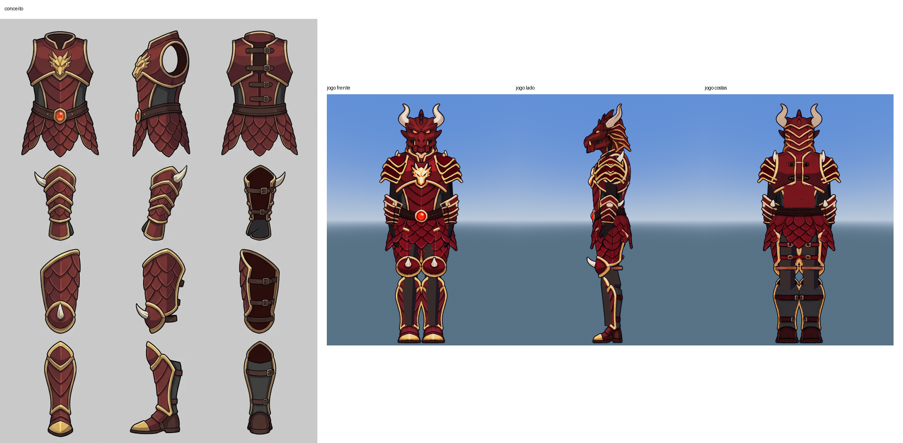
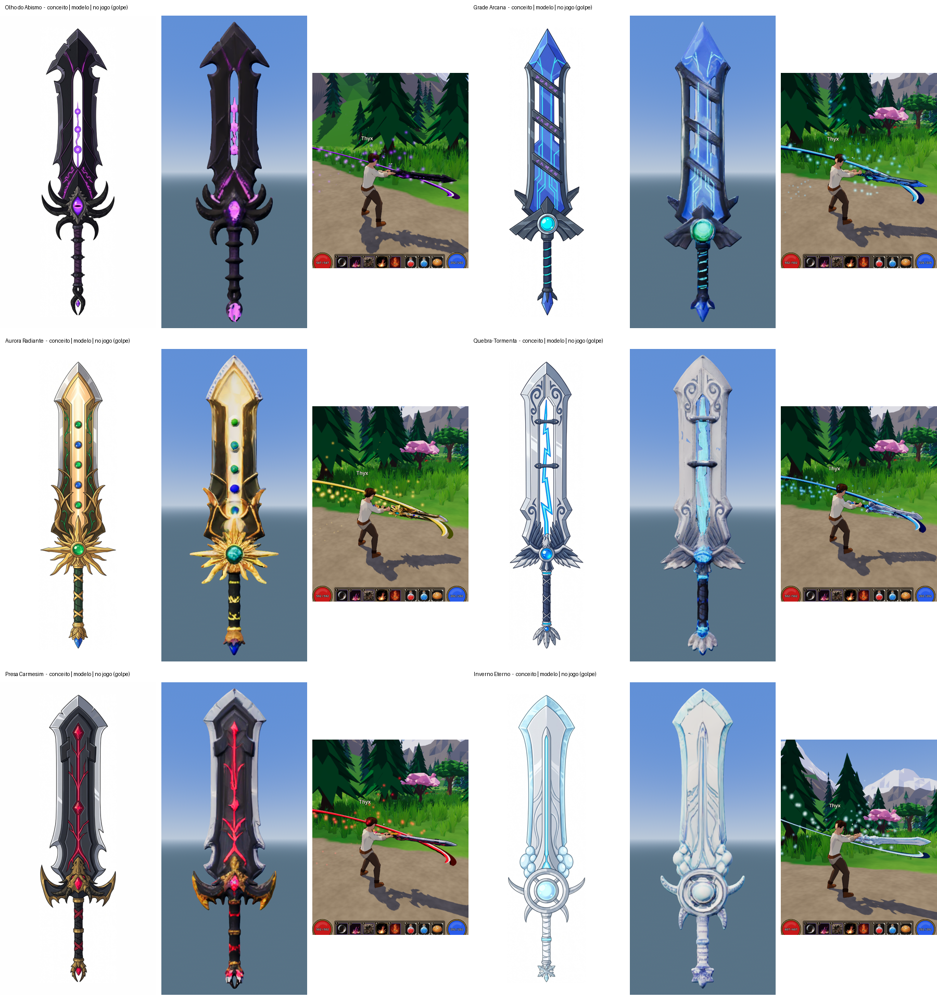

# Equipamento por IA: da imagem de referência ao modelo no jogo

Processo usado no Elmo Cabeça de Dragão e na Armadura do Dragão Vermelho (novembro de 2026), e o que deu errado
no caminho, para as próximas peças (armaduras, armas, escudos) não repetirem os mesmos erros.
O comando `/equipamento-ia` (`.claude/skills/equipamento-ia/SKILL.md`) segue este documento passo a passo.
Detalhes técnicos de instalação e de cada script: `tools/ia3d/LEIAME.md`.

## Visão geral

| Etapa | Ferramenta | Tempo |
|---|---|---|
| 1. Vistas | folha do usuário (frente, lado, costas) → `tools/ia3d/recortar_folha.py` | segundos |
| 2. Malha | `tools/ia3d/gerar.py` (Hunyuan3D-2mv, GPU AMD) | ~1,5 min por peça |
| 3. Redução | `tools/ia3d/reduzir.py` (só a peça maior, 40 mil faces) | segundos |
| 4. Pintura | `tools/ia3d/pintar.py` (textura do Hunyuan3D-2, 2048 px) | 1–2 min por peça, 9 GB de VRAM |
| 5. Base | `tools/blender/dragon_ia_peca_prep.py` (redução com UV, giro, cortes, limpeza) | segundos |
| 6. Estilo | builder em `tools/blender/gear.py` (lugar no corpo, pele ou pivô, espelho) | — |
| 7. Fotos | `tools/ia3d/rodada.sh` (`tools/look_shot.tscn`) | ~1 min |

Os passos 2 a 4 de várias peças rodam juntos com `bash tools/ia3d/lote.sh <peça> ...` (uma de cada vez na GPU).
O gerador e os pesos ficam fora do repositório, em `D:\ia3d` (variável `IA3D`).

## Regras que valem para toda peça

1. **A pintura é a da IA.** Pintar por regras de geometria e projetar o desenho do conceito na malha foram
   tentados e ficaram piores (manchas, cor fora do lugar). Não volte a isso: a textura da IA vai direto para o jogo
   (material `_flat`, sem AO nem `cel_paint`, textura em JPEG).
2. **Uma folha com as vistas da peça sozinha.** Fundo liso, uma peça por célula, sem corpo nem manequim dentro.
   No lado, a frente da peça aponta para a esquerda da imagem.
3. **Conferir as vistas entre si antes de gerar.** Em peça assimétrica (ombreira, braçadeira, arma com gancho),
   o detalhe tem de cair do mesmo lado da peça na frente e nas costas (nas costas ele aparece do lado oposto da
   imagem). A ombreira veio com o chifre trocado nas costas e a malha saiu com **dois chifres**
   ([rodada 1](renders/armadura_dragao_ia/erro_dois_chifres.png)); espelhar a vista de costas resolveu.
   Se a vista de lado contradiz as outras (o chifre da braçadeira), gere com e sem ela e escolha.
4. **Olhar a malha bruta antes de pintar** (quatro vistas em cinza). O gerador inventa: placa solta atrás (o fundo
   escuro da vista de costas virou um disco), lascas, segundo chifre. `reduzir.py` fica só com a peça maior;
   confira que a peça maior é a certa (na ombreira, a lâmina de baixo era uma peça separada e quase foi descartada).
5. **Sem partes soltas.** O build imprime `LOOSE <estilo>: ...`. Num par esquerda/direita é normal aparecer o lado
   direito separado do esquerdo; qualquer outra coisa é defeito.
6. **Uma peça por rodada no começo**, sempre com folha conceito x jogo (frente, 3/4, lado, costas, braços
   abertos, corrida). Depois que o processo da peça está validado, as outras do conjunto podem vir juntas.

## Como a peça acompanha o corpo

A malha da IA é rígida. Cada peça escolhe um de dois caminhos:

- **Rígida, presa a um pivô** (gira inteira com ele): ombreira (`Arm`), coxote com joelheira (`Leg`), braçadeira
  (`Elbow`), elmo (`Head`), arma (mão). O lado direito é o espelho do esquerdo (`_dgia_place`: espelha e vira as
  faces). Greva com bota é cortada no tornozelo em duas rígidas: canela no `Knee`, pé no `Ankle`.
- **Com pele** (dobra com o esqueleto): peitoral com saia. Vai para o esqueleto em `g_skin_finish` com os pesos
  de `_gb_skirt_w` (tronco em cima, coxas na saia). As rígidas da mesma armadura entram no mesmo esqueleto,
  100% no osso do pivô.
- **Mãos não vêm da IA**: o jogo troca mão fechada e aberta, e a IA faz uma pose só. Corte a luva da IA no punho
  (`PECAS["braco"]`, corte em z) e faça as mãos por código (`soft_fist`, `relaxed_hand`).

## Erros que custaram rodadas (e como evitar)

| Erro | Causa | Como evitar |
|---|---|---|
| Dois chifres na ombreira | vista de costas com o detalhe do lado trocado | regra 3; se escapar, `tira_chifre_de_dentro` no preparo |
| Raiz do chifre apagado com mancha dourada | a pintura suja a placa em volta do chifre | repintar a vizinhança com o vermelho da placa |
| Remendo laranja nas costas | "mais vermelho" medido como `r - max(g, b)` escolhe o friso laranja | medir como `r - 2*max(g, b)` (vermelho escuro da placa) |
| Emblema da frente vazou para as costas | a pintura projeta as vistas e uma atravessa a peça fina | caixa em `LIMPA` no preparo, repintada com a cor da placa |
| **Corpo aparecendo entre as peças** ([antes x depois](renders/armadura_dragao_ia/erro_encaixe_tubo.png)) | escala medida pela caixa da peça inteira: na greva a profundidade incluía o pé e a placa da frente puxava o centro | peças em tubo encaixadas pelo **vão de dentro** (`_dgia_cavity`) e conferidas com `_dgia_enclose` (`ENVOLVE ... descobertos`) |
| Calça furando a greva no tornozelo; fresta no tornozelo na corrida ([antes x depois](renders/armadura_dragao_ia/erro_tornozelo_costas.png)) | camada de baixo inteira por dentro de um tubo que afina; corte seco entre canela e pé | camada de baixo só onde a peça é aberta; corte com sobreposição (canela 1,5 cm abaixo, pé 2 cm acima) |
| Calça cinza atrás das coxas e dos joelhos | aberturas que o conceito tem (correias, couro mais baixo atrás) mostravam a calça do corpo | camada nas aberturas na cor do couro tirado da textura da IA (`DGIA_LEATHER`) |
| Peças da IA sem versão feminina | o builder chamava `export` direto e pulava a deformação do corpo feminino | exportar sempre por `_dgia_export` (rígidas) ou `g_export_skinned` (com pele) |

## Conferência antes de mostrar ao usuário

- [ ] Build sem `LOOSE` inesperado; `ENVOLVE` com 0–2% de pontos descobertos nas peças em tubo.
- [ ] Folha conceito x jogo nas seis poses; de perto: `legs`, `feet` (tornozelo), `torso back`, `bust`.
- [ ] Nenhum pedaço do corpo ou da calça aparecendo entre as peças, de frente, de lado, de costas e na corrida.
- [ ] Versão feminina (`<estilo>_f`) gerada e fotografada com `fem`. Versão do anão: **em pausa** até o
      usuário decidir (o build não gera `_d`).
- [ ] No jogo de verdade: `godot --path . res://scenes/world.tscn -- --level=60 --weapon=<arma> --equip=<ids>`.

## Armas

Primeiro uso: as seis montantes de nível 50 (novembro de 2026, `build_gsia` em `tools/blender/armory.py`).

Arma é uma peça rígida só, então não tem pele nem espelho, mas tem convenções próprias (`tools/blender/armory.py`):

- Centro da empunhadura na origem, frente = -Y. Espada `w_*`: lâmina em +Z, largura em X. Cajado `st_*`: haste em
  +Z, mão em z = 0,3. Arco `bw_*`: braços em ±Z, corda fora do GLB. Um empty `Tip` marca a ponta (efeitos e rastro).
- **Vistas: só frente e costas.** O Gemini não desenha a vista de lado de uma espada (gira a guarda junto ou
  desenha a mesma face mais estreita), e o Hunyuan3D-2mv acerta a espessura sem ela (lâmina de ~5 cm em 2 m).
  Pedir a arma **deitada** (frente em cima, costas embaixo, ponta para a direita) aproveita a imagem larga;
  `tools/ia3d/recortar_arma.py` põe de pé e espelha as costas (o Gemini desenha as costas como a arma girada no
  próprio eixo; o gerador quer a vista de trás).
- Escala: montante tem 2 m (passa da altura do herói, ~1,8 m). O cabo não é medido pelo trecho estreito (anéis
  com espinhos e pomo fino quebram o trecho): a guarda é a faixa mais larga da metade de baixo e a pegada fica
  `GSIA_HANDS` (25 cm) abaixo dela. Conferir com `tools/weapon_shot.gd` e no jogo (`--level=60 --weapon=<id>`,
  `--autoswing --shots=3,0.25` para o golpe).
- Preparo: `dragon_ia_peca_prep.py` com as peças `gs_*` (giro 0, sem espelho). Brilho: o builder tira da própria
  pintura uma textura de emissão (pixels no tom da arma); aura: empties `Aura_<tipo>_<n>` na guarda, na ponta e
  nas duas bordas da lâmina, que `BowAura` liga em partículas (tipos em `scripts/player/bow_aura.gd`).

### Erros das montantes (e como evitar)

| Erro | Causa | Como evitar |
|---|---|---|
| Espada inteira branca no jogo | o shader toon (`toon_character.gdshader`) usava a cor de emissão (branca) e ignorava a textura de emissão | o toon agora multiplica pela `emission_tex`; arma nova com emissão por textura já funciona |
| Decalque, tinta e redução para 1024 px sumiam no jogo | a imagem vem empacotada no GLB: `save()`/`pack()` gravam os bytes originais | nas `gs_*` o preparo copia os pixels para uma imagem nova antes de salvar (os GLBs caíram de ~1 MB para ~0,5 MB) |
| Traços finos perdidos (circuitos do Arcano, orbes do Abismo, penas da águia) | a pintura da IA borra o que tem poucos pixels | `DECAL` no preparo: só as linhas na cor alvo do conceito, nas faces de frente e de costas (lâmina plana, malha gerada das mesmas vistas). Não é a projeção inteira da regra 1 |
| Fenda fechada / raio sem vão | o gerador fechou parte do vão | `FURO`: faces de frente/costas que caem no fundo do conceito nas duas vistas saem |
| Guarda virou bloco | uma semente ruim e a pintura clara apagando as penas | gerar com outras sementes (`gerar.py --semente 7 --octree 512`), comparar em cinza e decalcar a cor escura (o filtro mede o brilho relativo à cor alvo) |
| Máscara de brilho pegando o cristal inteiro (32%) | tolerância de tom larga demais | tolerância 0,55; conferir a linha `BRILHO ... % da textura` (0,5–15% é o normal) |
