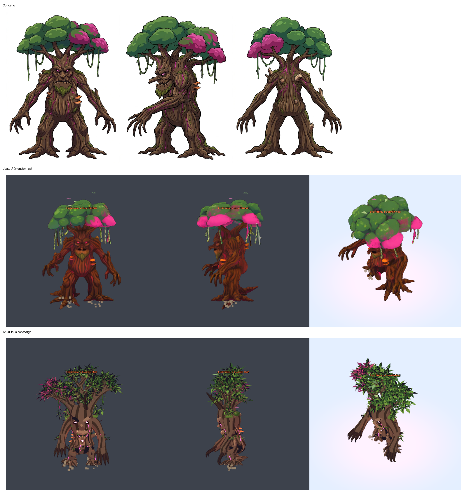
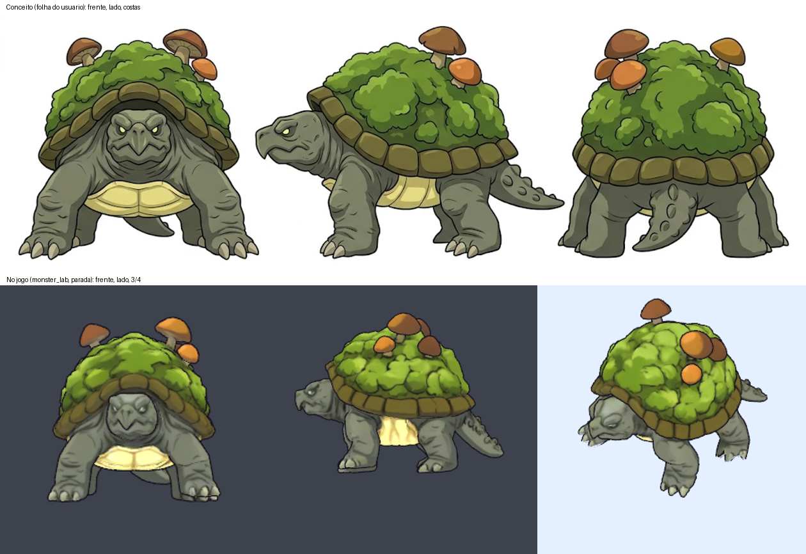
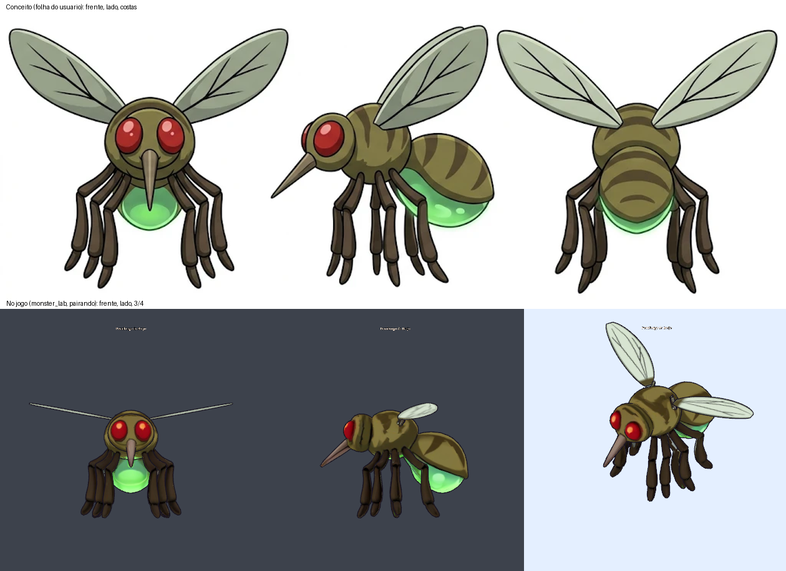
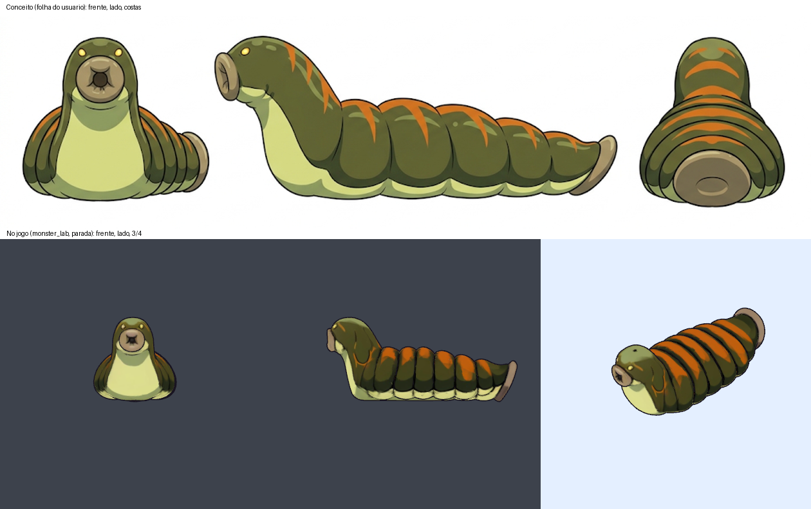
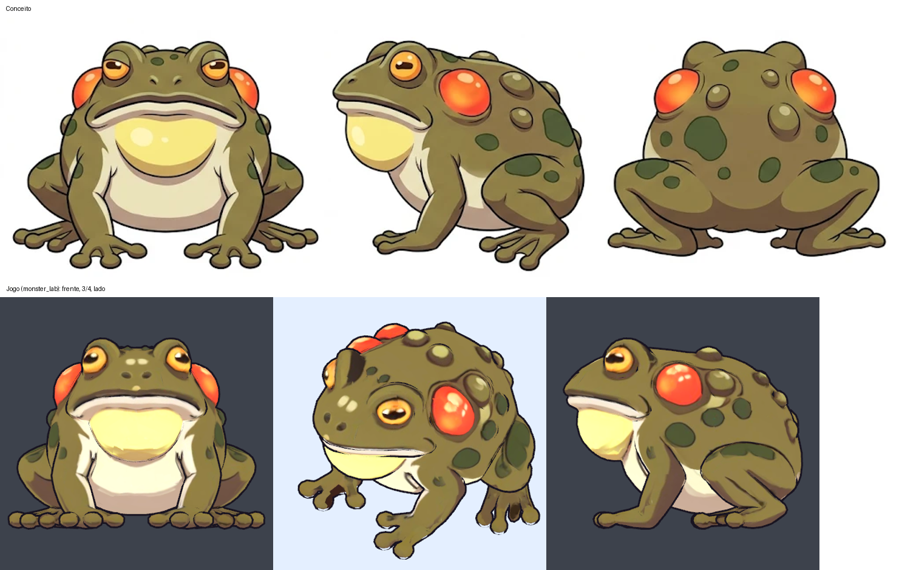

# Equipamento por IA: da imagem de referência ao modelo no jogo

Processo usado no Elmo Cabeça de Dragão e na Armadura do Dragão Vermelho (novembro de 2026), e o que deu errado
no caminho, para as próximas peças (armaduras, armas, escudos) não repetirem os mesmos erros.
O comando `/equipamento-ia` (`.claude/skills/equipamento-ia/SKILL.md`) segue este documento passo a passo.
Detalhes técnicos de instalação e de cada script: `tools/ia3d/LEIAME.md`.

## Visão geral

| Etapa | Ferramenta | Tempo |
|---|---|---|
| 1. Vistas | folha do usuário (frente, lado, costas) → `tools/ia3d/recortar_folha.py` | segundos |
| 2. Malha | `tools/ia3d/gerar.py` (Hunyuan3D-2mv, GPU AMD) | ~1,5 min por peça |
| 3. Redução | `tools/ia3d/reduzir.py` (só a peça maior, 40 mil faces) | segundos |
| 4. Pintura | `tools/ia3d/pintar.py` (textura do Hunyuan3D-2, 2048 px) | 1–2 min por peça, 9 GB de VRAM |
| 5. Base | `tools/blender/dragon_ia_peca_prep.py` (redução com UV, giro, cortes, limpeza) | segundos |
| 6. Estilo | builder em `tools/blender/gear.py` (lugar no corpo, pele ou pivô, espelho) | — |
| 7. Fotos | `tools/ia3d/rodada.sh` (`tools/look_shot.tscn`) | ~1 min |

Os passos 2 a 4 de várias peças rodam juntos com `bash tools/ia3d/lote.sh <peça> ...` (uma de cada vez na GPU).
O gerador e os pesos ficam fora do repositório, em `D:\ia3d` (variável `IA3D`).

## Regras que valem para toda peça

1. **A pintura é a da IA.** Pintar por regras de geometria e projetar o desenho do conceito na malha foram
   tentados e ficaram piores (manchas, cor fora do lugar). Não volte a isso: a textura da IA vai direto para o jogo
   (material `_flat`, sem AO nem `cel_paint`, textura em JPEG).
2. **Uma folha com as vistas da peça sozinha.** Fundo liso, uma peça por célula, sem corpo nem manequim dentro.
   No lado, a frente da peça aponta para a esquerda da imagem.
3. **Conferir as vistas entre si antes de gerar.** Em peça assimétrica (ombreira, braçadeira, arma com gancho),
   o detalhe tem de cair do mesmo lado da peça na frente e nas costas (nas costas ele aparece do lado oposto da
   imagem). A ombreira veio com o chifre trocado nas costas e a malha saiu com **dois chifres**
   ([rodada 1](renders/armadura_dragao_ia/erro_dois_chifres.png)); espelhar a vista de costas resolveu.
   Se a vista de lado contradiz as outras (o chifre da braçadeira), gere com e sem ela e escolha.
4. **Olhar a malha bruta antes de pintar** (quatro vistas em cinza). O gerador inventa: placa solta atrás (o fundo
   escuro da vista de costas virou um disco), lascas, segundo chifre. `reduzir.py` fica só com a peça maior;
   confira que a peça maior é a certa (na ombreira, a lâmina de baixo era uma peça separada e quase foi descartada).
5. **Sem partes soltas.** O build imprime `LOOSE <estilo>: ...`. Num par esquerda/direita é normal aparecer o lado
   direito separado do esquerdo; qualquer outra coisa é defeito.
6. **Uma peça por rodada no começo**, sempre com folha conceito x jogo (frente, 3/4, lado, costas, braços
   abertos, corrida). Depois que o processo da peça está validado, as outras do conjunto podem vir juntas.

## Como a peça acompanha o corpo

A malha da IA é rígida. Cada peça escolhe um de dois caminhos:

- **Rígida, presa a um pivô** (gira inteira com ele): ombreira (`Arm`), coxote com joelheira (`Leg`), braçadeira
  (`Elbow`), elmo (`Head`), arma (mão). O lado direito é o espelho do esquerdo (`_dgia_place`: espelha e vira as
  faces). Greva com bota é cortada no tornozelo em duas rígidas: canela no `Knee`, pé no `Ankle`.
- **Com pele** (dobra com o esqueleto): peitoral com saia. Vai para o esqueleto em `g_skin_finish` com os pesos
  de `_gb_skirt_w` (tronco em cima, coxas na saia). As rígidas da mesma armadura entram no mesmo esqueleto,
  100% no osso do pivô.
- **Mãos não vêm da IA**: o jogo troca mão fechada e aberta, e a IA faz uma pose só. Corte a luva da IA no punho
  (`PECAS["braco"]`, corte em z) e faça as mãos por código (`soft_fist`, `relaxed_hand`).

## Erros que custaram rodadas (e como evitar)

| Erro | Causa | Como evitar |
|---|---|---|
| Dois chifres na ombreira | vista de costas com o detalhe do lado trocado | regra 3; se escapar, `tira_chifre_de_dentro` no preparo |
| Raiz do chifre apagado com mancha dourada | a pintura suja a placa em volta do chifre | repintar a vizinhança com o vermelho da placa |
| Remendo laranja nas costas | "mais vermelho" medido como `r - max(g, b)` escolhe o friso laranja | medir como `r - 2*max(g, b)` (vermelho escuro da placa) |
| Emblema da frente vazou para as costas | a pintura projeta as vistas e uma atravessa a peça fina | caixa em `LIMPA` no preparo, repintada com a cor da placa |
| **Corpo aparecendo entre as peças** ([antes x depois](renders/armadura_dragao_ia/erro_encaixe_tubo.png)) | escala medida pela caixa da peça inteira: na greva a profundidade incluía o pé e a placa da frente puxava o centro | peças em tubo encaixadas pelo **vão de dentro** (`_dgia_cavity`) e conferidas com `_dgia_enclose` (`ENVOLVE ... descobertos`) |
| Calça furando a greva no tornozelo; fresta no tornozelo na corrida ([antes x depois](renders/armadura_dragao_ia/erro_tornozelo_costas.png)) | camada de baixo inteira por dentro de um tubo que afina; corte seco entre canela e pé | camada de baixo só onde a peça é aberta; corte com sobreposição (canela 1,5 cm abaixo, pé 2 cm acima) |
| Calça cinza atrás das coxas e dos joelhos | aberturas que o conceito tem (correias, couro mais baixo atrás) mostravam a calça do corpo | camada nas aberturas na cor do couro tirado da textura da IA (`DGIA_LEATHER`) |
| Peças da IA sem versão feminina | o builder chamava `export` direto e pulava a deformação do corpo feminino | exportar sempre por `_dgia_export` (rígidas) ou `g_export_skinned` (com pele) |

## Conferência antes de mostrar ao usuário

- [ ] Build sem `LOOSE` inesperado; `ENVOLVE` com 0–2% de pontos descobertos nas peças em tubo.
- [ ] Folha conceito x jogo nas seis poses; de perto: `legs`, `feet` (tornozelo), `torso back`, `bust`.
- [ ] Nenhum pedaço do corpo ou da calça aparecendo entre as peças, de frente, de lado, de costas e na corrida.
- [ ] Versão feminina (`<estilo>_f`) gerada e fotografada com `fem`. Versão do anão: **em pausa** até o
      usuário decidir (o build não gera `_d`).
- [ ] No jogo de verdade: `godot --path . res://scenes/world.tscn -- --level=60 --weapon=<arma> --equip=<ids>`.

## Monstros (piloto: Lobo da Geada, novembro de 2026)

 — andando: `renders/lobo_ia/lobo_ia_walk.gif`, bote:
`renders/lobo_ia/lobo_ia_attack.gif`. **Caminho aprovado pelo usuário (2026-11-22)**: pele com os pivôs do monstro
de código vale para os próximos monstros.

O mesmo processo da armadura serve para monstros: folha com três vistas → `recortar_folha.py` → `lote.sh` (malha
e pintura da IA em ~3 min) → um builder no Blender (`tools/blender/wolf_ia_build.py`) → `assets/models/wolf_ia.glb`.
A diferença é a animação: o monstro dobra em várias juntas, então a malha vai **com pele**, não em peças rígidas.

- **Vistas.** Pose neutra pedida no prompt: patas retas e afastadas do corpo e entre si, boca fechada, cauda erguida
  e longe das patas. Saiu uma malha de uma peça só, sem lascas. No lado, a cabeça para a esquerda da imagem.
  Três imagens soltas viram uma folha de uma linha colando lado a lado (fundo igual).
- **Pele, não peças.** O pelo do ombro e da coxa nasce de dentro do tronco: cortado em partes rígidas, a emenda
  apareceria em toda dobra. O GLB traz os **mesmos pivôs** do monstro feito por código (nomes e hierarquia), mais
  um esqueleto com um osso por pivô (a cabeça do osso no pivô). No jogo o `PivotSkin` faz cada osso seguir o seu
  pivô, então o código de animação (`enemy.gd`) não muda.
- **Ossos `<pivô>_skin`.** Com pivôs e ossos de mesmo nome no mesmo GLB, o importador do Godot renomeia os ossos
  para `Body_2`, `Head_2`... e o `PivotSkin` não acha os pivôs (o modelo fica parado). O sufixo `_skin` é tirado
  pelo `PivotSkin`.
- **Pivôs medidos na malha.** Fatias horizontais de cada pata (centro em y e z a cada 5 cm) dão ombro/quadril,
  cotovelo/joelho, punho/jarrete e apoio. A malha da IA não é simétrica (patas ~2 cm diferentes em x): cada pata
  tem o seu x. O IK do jogo (`_wolf_setup`) lê os comprimentos dos pivôs, então as proporções novas valem sozinhas.
- **Pesos por regra, não automáticos.** Região do corpo (pata abaixo da barriga, cabeça na frente do pescoço,
  cauda atrás da garupa) e, dentro da pata, o segmento mais perto com mistura de 5 cm na junta; da barriga até o
  topo do pivô a pata passa para o `Body`. Os cristais das costas ficam 100% no `Body` (não entortam).
- **Boca.** A IA entrega a boca fechada numa casca só. O builder corta na linha da boca pintada (plano pelo canto
  e pela frente do lábio), separa os lábios, põe a parte de baixo 100% na mandíbula (`Jaw`, dobradiça atrás do
  canto) e um saco escuro por dentro, metade na cabeça e metade na mandíbula, que tapa o vão quando abre. A mandíbula
  da IA é fina (1,5 cm na frente): o saco sobe para dentro do focinho e acaba antes da frente, senão fura o queixo.
- **Ver no jogo.** Antes de trocar, `godot --path . res://tools/monster_lab.tscn -- --kind=lobo_geada --mode=walk|attack --glb=<glb>`
  (laboratório) ou `--monster-glb=<modelo>:<glb>` (jogo) trocam só o GLB (`EnemyModel.swap`); `Enemy` liga o
  `PivotSkin` sozinho quando o modelo tem esqueleto.
- **Troca no jogo.** `EnemyModel.MODELS["wolf"]` aponta para `wolf_ia.glb`, e a estátua do lobo na dungeon das raízes
  (`map_dungeon.gd`, `STATUES`) também; a malha com pele em repouso serve de estátua. O `wolf.glb` de código continua
  sendo gerado pelo `build_assets.py` e serve para comparar: `--glb=wolf` no laboratório.

No jogo (`--monster-glb=wolf:wolf_ia`, na Mina perto de x 785, z 34) o usuário achou "bem melhor que o atual", mas o
movimento das **patas de trás** ficou estranho. Causa: só a parte de baixo da coxa ia na perna (`LegB*`), o resto
ficava no `Body`; a coxa ficava parada e a canela girava embaixo dela. Correção (aprovada,
`renders/lobo_ia/patas_tras_r2.gif`): a coxa inteira segue a perna, pela distância ao eixo quadril-joelho no perfil,
até perto do pivô do quadril; só a face de dentro, junto da barriga, fica no `Body`. Para conferir pesos, pinte cada
vértice com a cor do osso dominante e marque os pivôs numa vista de lado.
O usuário pediu a troca no jogo (2026-11-22): o Lobo da Geada e o Lobo Alfa usam o `wolf_ia.glb`.
Em aberto: olhos e cristais sem brilho (a pintura da IA é fosca; o conceito tem olhos e
cristais acesos), custo de 14 mil faces com pele numa horda cheia (`/perf-profile`).

### Espinheira, a Guardiã-Raiz (chefe do Covil das Raízes; rodada 1 aprovada em 2026-11-22)

 — `tools/blender/thorn_ia_build.py` →
`assets/models/thorn_tree_ia.glb` (6,3 m, 20 mil faces, textura 2048). Folhas do lab em `renders/espinheira_ia/ia_*.png`
(andar, varrer e as três habilidades: raízes, brotos, esporos). É o modelo da Espinheira no jogo
(`EnemyModel.MODELS["thorn_tree"]`); a de código continua em `thorn_tree.glb` (`--glb=thorn_tree` no monster_lab).

- **Vista de lado diferente das outras não estragou.** No lado o braço veio esticado para a frente; na frente e nas
  costas, aberto e para baixo. O gerador seguiu frente e costas (braço aberto, um pouco para a frente). Vale gerar
  antes de pedir outra imagem.
- **Copa em tufos grandes** (pedido no prompt: "chunky stylized leaf masses, not individual leaves") saiu limpa e
  de uma peça só. Os cipós finos também (presos na copa, longe dos braços).
- **Cipós achados por fatia.** Em cada fatia de 6 cm, grupos de vértices ligados a até 15 cm; grupo com menos de
  30 cm é fio. Com 7 cm a malha reduzida (~8 cm entre vértices) quebrava o tronco em "fios" e o alto do tronco ia
  inteiro para o `Hang`. Filtros que faltaram: a ponta de baixo do fio fica fora da planta do tronco, e o fio sobe
  até a copa (z > 4); sem eles, os tocos de galho do ombro viravam cipó. Cada fio vai no `Hang` do lado e da metade
  (frente/trás) dele, com a raiz misturada no galho.
- **Regra de um membro não pode pegar o outro.** A massa do quadril (z 1,3–1,95) ia para a perna sem limite em x, e
  as mãos pendem nessa mesma altura (x ~2): os dedos ficaram 85% na perna e viraram tiras esticadas quando o braço
  subia no golpe. Toda regra de região precisa de um limite no eixo do membro. Abaixo da virilha, ponto mais perto da
  mão que da coluna da perna é dedo. Conferir com a contagem de grupos por vértice de um lado (`LegR+HandR` = erro),
  não só pela cor do osso dominante, que esconde mistura.
- **Boca na fenda esculpida.** A pintura quase não mostra a boca, mas a IA esculpiu a fenda sob o nariz: o corte
  segue a fenda (z 3,345) e para antes da ponta do nariz, que desce até a mesma altura mais à frente (cortá-la soltou
  uma lasca de 17 vértices, e o resto do nariz ia junto com a mandíbula). O saco escuro precisa de UV e textura lisa,
  senão a prévia de textura mostra branco.
- **Em aberto:** com o tronco curvado (raízes, esporos) a copa, mais alta e maior que a de código, desce na frente
  do rosto; o rosa das veias virou um tom avermelhado espalhado e a copa rosa vazou para os dois lados; a pintura
  é fosca (olhos sem brilho), como no lobo.

### Tartaruga-Musgo (Pântano Sussurrante; rodada 1 aprovada em 2026-11-22)

 — andando: `renders/tartaruga_ia/tartaruga_andar.gif`,
bote: `renders/tartaruga_ia/tartaruga_bote.gif` (de perto: `tartaruga_bote_close.gif`), pesos: `renders/tartaruga_ia/pesos.png`.
`tools/blender/turtle_ia_build.py` → `assets/models/turtle_ia.glb` (10 mil faces). Primeiro dos monstros próprios do
Pântano, que repetia os da vila: o tipo `tartaruga_musgo` tem os números do Slime de Gelo (vida, dano, lentidão,
resistências, loot) e ocupa os 17 lugares dele no `bosque.tscn`; a vila continua com o slime. Usa os pivôs e a
animação do lobo (`_animate_wolf`, modelo `turtle`) com passada curta e um bote próprio: recolhe o pescoço com o bico
aberto, estica a cabeça e fecha no acerto (é o `lunge` do slime, sem o pulo).

- **Folha numa imagem só funciona**, mas as vistas vieram encostadas (garra da frente na cabeça do lado, cauda na
  vista de costas) e o `recortar_folha.py` achou uma faixa só. Afastar as vistas numa cópia (cortar em x e apagar o
  pedaço da vizinha) resolveu; no prompt, pedir "wide empty white space between them".
- **Mistura de junta pelo eixo, não pelo ponto.** O `leg_weights` do lobo mistura perto do ponto da junta (3–5 cm);
  na pata grossa da tartaruga (raio ~0,11) a pele fica toda fora desse raio, a junta vira corte seco e, no passo, a
  pele dobra para dentro e o contorno preto do toon aparece pelo vão (manchas pretas que mudam a cada quadro; o lobo
  tem algumas menores). Mistura pela altura ao longo do eixo da pata (±4,5 cm no cotovelo, ±3 cm no punho).
- **Pata = raio em volta do eixo.** Com limite em `|y - eixo|` e `|x|` o calcanhar e a frente do pé ficavam meio no
  `Body` e rasgavam. O eixo tem que passar no centro da coluna da pata (fatias com `|x| > 0,25`, fora da barriga);
  perto do chão (z < 0,14) não há barriga e o pé inteiro vai na pata.
- **Pescoço = tubo, com capuz.** A borda da frente do casco desce por baixo até z 0,60 em `|x|` 0,1, mais alta que o
  pescoço ali: com limite só em x e z a borda ia junto com a cabeça e virava uma ponta marrom no bote. Com tubo de
  corte seco abria um buraco escuro entre a borda e o pescoço esticado. O que serviu: tubo em volta do eixo do pescoço
  com a borda macia até r 0,19 (a pele de dentro da borda estica como um capuz) e a borda de fora (r > 0,2) parada.
- **Diagnóstico das manchas:** `--nooutline` e `--notoon` no `monster_lab` separam contorno de malha; a malha não
  tinha faces dobradas (contagem de normais opostas às vizinhas: 0) nem LOD culpado (`generate_lods=false` não mudou
  nada e ficou assim no `.import`). Reimportar o GLB exportado no Blender e listar os grupos de cada vértice da pata
  achou os vértices meio no `Body`.
- **Em aberto:** olhos foscos (no conceito brilham), a lentidão ainda tem o efeito visual de gelo e a tartaruga
  herdou as resistências do slime (imune a gelo).

### Pernilongo do Brejo (Pântano Sussurrante; rodada 2 aprovada em 2026-11-23)

 — voo: `renders/pernilongo_ia/pernilongo_voo.gif` (câmera
lenta: `pernilongo_voo_camera_lenta.gif`), rasante: `pernilongo_rasante.gif`, asas vistas de cima: `asas_de_cima.png`.
`tools/blender/mosquito_ia_build.py` → `assets/models/mosquito_ia.glb` (8 mil faces + duas asas). Tipo
`pernilongo_brejo` com os números do Slime Veloz nos 14 lugares dele no `bosque.tscn`; `height` 1,4 (voa: com 0,6 os
golpes passariam por baixo). Pivôs da Asa-couro (`Body` pairando a 1,5, `Head`, `WingL`, `WingR`) mais um `Tail` no
abdômen; animação `_animate_bat` (modelo `mosquito`) com o abdômen balançando e encolhendo no rasante.

- **Asas da IA reprovadas.** Vieram em V (como a imagem, apesar de "spread flat out to the sides" no prompt), com
  borda rasgada (lâmina fina) e dobra na raiz. O usuário quer asas na horizontal e bonitas: o builder corta a asa da
  IA (fora do tórax em x e acima do ombro, e a raiz que sobe acima do tórax — sem isso sobram dois tocos em pé nos
  ombros), fecha o buraco (`holes_fill`, com UV copiado dos vizinhos; sem isso a tampa lê o canto cinza da
  textura) e faz asas novas: lâmina de 1 cm em forma de folha (`sqrt(sin(πu))` arredonda as pontas), veios e borda
  pintados numa textura gerada no builder, raiz 4 cm dentro do tórax e na cor do corpo. Asa fina é parte que a IA não
  faz bem: para insetos, já planejar asa por código.
- **Batida de inseto não segue o passo.** A da Asa-couro cresce com a velocidade (`anim_t`); o mosquito bate a
  ~18 Hz sempre (`_life_t`, fase por indivíduo), amplitude 0,5. Em GIF não aparece (aliasing): mostrar também em
  câmera lenta (`--span=0.111 --frames=16`, ~2 batidas).
- **Patas finas por fatia, na malha cheia.** Grupo pequeno de vértices ligados numa fatia de 4 cm é pata. Na malha
  reduzida (arestas ~4 cm) a fatia do abdômen quebrava em pedaços e virava "pata" (faixa cinza no abdômen): achar na
  malha de 40 mil faces e passar para a reduzida pelo vértice mais perto (`KDTree`). O ferrão também é fino e baixo:
  a busca só vale atrás dele (y > -0,45), senão a ponta ficava no `Body` e dobrava na pose de teste.
- **Asa e abdômen pela altura, não por y.** Perto da raiz a asa da IA se estendia para trás por cima do abdômen;
  limite da asa em z (o alto do abdômen fica abaixo de 0,18) e o abdômen nunca no mesmo vértice da asa.

### Sanguessuga do Lodo (Pântano Sussurrante; rodada 1 aprovada em 2026-11-23)

 — rastejando: `renders/sanguessuga_ia/sanguessuga_rastejar.gif`,
bote: `sanguessuga_bote.gif`, pesos: `pesos.png`. `tools/blender/leech_ia_build.py` → `assets/models/leech_ia.glb`
(8 mil faces). Tipo `sanguessuga_lodo` com os números do Slime nos 10 lugares dele no `bosque.tscn` (dois não tinham
`kind` e usavam o padrão "slime": receberam o tipo escrito). Primeiro monstro por IA sem esqueleto de outro: cadeia
nova (`Head` < `Body` > `Tail` > `Tail2` > `Tail3`) e um `_animate_leech` (onda de lado a lado que corre da cabeça à
cauda, cada gomo com atraso; bote que ergue a frente e dispara a cabeça, com o pulo do slime).

- **Vista de frente girada não estragou.** A folha veio com a frente em quase 3/4 (a cauda saindo de lado); a malha
  saiu reta e simétrica assim mesmo.
- **Cadeia: só vizinhos dividem vértice.** Pesos pela posição ao longo do eixo com mistura de ±6 cm em cada pivô; a
  conferência marca como erro qualquer par que não seja vizinho na cadeia.
- **Osso a cada gomo e meio.** Com 4 ossos o meio do corpo (0,5 de comprimento) ficava rígido e a onda saía dura;
  com o corpo dividido em Body, Tail, Tail2 e Tail3 (~0,22 cada) a curva em S fica lisa.
- **Onda pela direção absoluta.** Cada gomo tem a sua direção `A·sin(fase - i·atraso)`; o giro de cada pivô é a
  diferença para o pai. Assim a onda anda pelo corpo sem acumular giro na ponta.

### Sapo-Bufo (Pântano Sussurrante; rodada 1 aprovada em 2026-11-23)

 — pulando: `renders/sapo_ia/sapo_pulando.gif`, pavio e estouro:
`sapo_estouro.gif`, pesos: `pesos.png`, malha bruta: `malha_bruta.png`. `tools/blender/toad_ia_build.py` →
`assets/models/toad_ia.glb` (8 mil faces). Tipo `sapo_bufo` com os números do Slime Explosivo (bomber, `blast` 3,2) no
bando de 4 do `bosque.tscn`. Pivôs do sapo de código sem mandíbula nem língua (o bomber não usa boca): `Body` no centro
da barriga e as patas filhas da raiz (`ArmL/R` > `HandL/R`, `LegL/R` > `FootL/R`); animação `_animate_toad` (modelo
`toad`): pulinhos (agacha, voa com as pernas para trás, amassa ao pousar) e, no `fuse`, o `Body` incha 1,5x pulsando
e treme cada vez mais rápido até o estouro.

- **Inchar = escala do Body com o pivô no meio.** Com o pivô embaixo o corpo cresceria só para cima. O jogo sobe o
  pivô junto (`(escala - 1) * (altura do pivô - barriga)`), senão a barriga afunda no chão.
- **Patas não crescem, mas a raiz acompanha.** A coxa grossa do sapo é quase toda `Body` (incha) e a canela é `Leg`
  (não incha): parado, abria um vão escuro entre as duas. O jogo afasta o pivô de cada pata do meio na mesma proporção
  do inchaço, só no chão (x e z); a pata abre como a de um sapo estufado e o pé não sai do chão.
- **Mão e pé pela altura, com folga.** As pontas dos dedos são bolas até z 0,08 e o dedo de dentro chega a |x| 0,05;
  fora da regra eles ficavam no `Body` e rasgavam em tiras no inchaço. Tudo abaixo de z ~0,09 à frente da barriga é
  mão, e atrás (|x| > 0,14) é pé; a barriga só começa em z 0,1 na frente e fica em |x| < 0,13 embaixo.
- **Luz do bomber.** Todo bomber ganha uma `OmniLight3D` da cor do tipo (o slime é a brasa); no sapo ela pintava a
  pintura inteira de laranja. Desligada para o modelo `toad` (as glândulas já vêm pintadas).
- **Medir pivôs:** fatias em z com grupos ligados ficam ruidosas numa casca de 40 mil faces (a fatia da pele vira
  dezenas de lascas). O que serviu: mapa de ocupação em ASCII por faixa de z (células de 2,5 cm em x/y) e vistas
  ortográficas com grade de 5 cm atrás da malha.
- **Em aberto:** cada lado tem duas glândulas laranja encostadas (o conceito tem uma); na vista 3/4 a pálpebra do olho
  de trás aparece como uma ponta escura (vem da pintura da IA); com o inchaço máximo ficam linhas leves de pele
  esticada na coxa.

## Armas

Primeiro uso: as seis montantes de nível 50 (novembro de 2026, `build_gsia` em `tools/blender/armory.py`).

Arma é uma peça rígida só, então não tem pele nem espelho, mas tem convenções próprias (`tools/blender/armory.py`):

- Centro da empunhadura na origem, frente = -Y. Espada `w_*`: lâmina em +Z, largura em X. Cajado `st_*`: haste em
  +Z, mão em z = 0,3. Arco `bw_*`: braços em ±Z, corda fora do GLB. Um empty `Tip` marca a ponta (efeitos e rastro).
- **Vistas: só frente e costas.** O Gemini não desenha a vista de lado de uma espada (gira a guarda junto ou
  desenha a mesma face mais estreita), e o Hunyuan3D-2mv acerta a espessura sem ela (lâmina de ~5 cm em 2 m).
  Pedir a arma **deitada** (frente em cima, costas embaixo, ponta para a direita) aproveita a imagem larga;
  `tools/ia3d/recortar_arma.py` põe de pé e espelha as costas (o Gemini desenha as costas como a arma girada no
  próprio eixo; o gerador quer a vista de trás).
- Escala: montante tem 2 m (passa da altura do herói, ~1,8 m). O cabo não é medido pelo trecho estreito (anéis
  com espinhos e pomo fino quebram o trecho): a guarda é a faixa mais larga da metade de baixo e a pegada fica
  `GSIA_HANDS` (25 cm) abaixo dela. Conferir com `tools/weapon_shot.gd` e no jogo (`--level=60 --weapon=<id>`,
  `--autoswing --shots=3,0.25` para o golpe).
- Preparo: `dragon_ia_peca_prep.py` com as peças `gs_*` (giro 0, sem espelho). Brilho: o builder tira da própria
  pintura uma textura de emissão (pixels no tom da arma); aura: empties `Aura_<tipo>_<n>` na guarda, na ponta e
  nas duas bordas da lâmina, que `BowAura` liga em partículas (tipos em `scripts/player/bow_aura.gd`).

### Erros das montantes (e como evitar)

| Erro | Causa | Como evitar |
|---|---|---|
| Espada inteira branca no jogo | o shader toon (`toon_character.gdshader`) usava a cor de emissão (branca) e ignorava a textura de emissão | o toon agora multiplica pela `emission_tex`; arma nova com emissão por textura já funciona |
| Decalque, tinta e redução para 1024 px sumiam no jogo | a imagem vem empacotada no GLB: `save()`/`pack()` gravam os bytes originais | nas `gs_*` o preparo copia os pixels para uma imagem nova antes de salvar (os GLBs caíram de ~1 MB para ~0,5 MB) |
| Traços finos perdidos (circuitos do Arcano, orbes do Abismo, penas da águia) | a pintura da IA borra o que tem poucos pixels | `DECAL` no preparo: só as linhas na cor alvo do conceito, nas faces de frente e de costas (lâmina plana, malha gerada das mesmas vistas). Não é a projeção inteira da regra 1 |
| Fenda fechada / raio sem vão | o gerador fechou parte do vão | `FURO`: faces de frente/costas que caem no fundo do conceito nas duas vistas saem |
| Guarda virou bloco | uma semente ruim e a pintura clara apagando as penas | gerar com outras sementes (`gerar.py --semente 7 --octree 512`), comparar em cinza e decalcar a cor escura (o filtro mede o brilho relativo à cor alvo) |
| Máscara de brilho pegando o cristal inteiro (32%) | tolerância de tom larga demais | tolerância 0,55; conferir a linha `BRILHO ... % da textura` (0,5–15% é o normal) |
