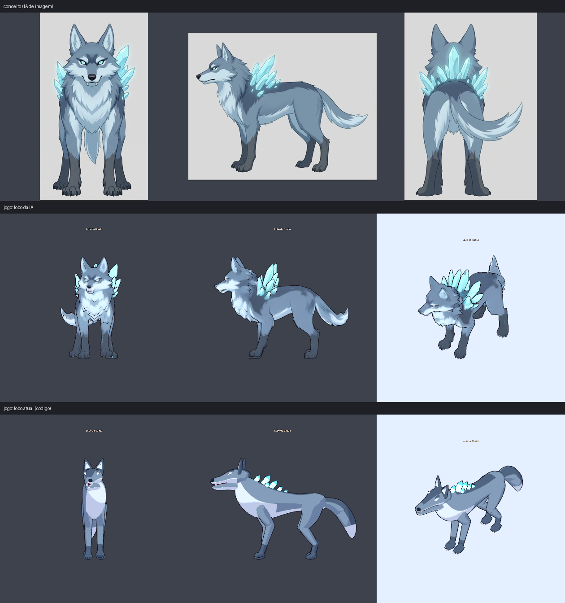

# Equipamento por IA: da imagem de referência ao modelo no jogo

Processo usado no Elmo Cabeça de Dragão e na Armadura do Dragão Vermelho (novembro de 2026), e o que deu errado
no caminho, para as próximas peças (armaduras, armas, escudos) não repetirem os mesmos erros.
O comando `/equipamento-ia` (`.claude/skills/equipamento-ia/SKILL.md`) segue este documento passo a passo.
Detalhes técnicos de instalação e de cada script: `tools/ia3d/LEIAME.md`.

## Visão geral

| Etapa | Ferramenta | Tempo |
|---|---|---|
| 1. Vistas | folha do usuário (frente, lado, costas) → `tools/ia3d/recortar_folha.py` | segundos |
| 2. Malha | `tools/ia3d/gerar.py` (Hunyuan3D-2mv, GPU AMD) | ~1,5 min por peça |
| 3. Redução | `tools/ia3d/reduzir.py` (só a peça maior, 40 mil faces) | segundos |
| 4. Pintura | `tools/ia3d/pintar.py` (textura do Hunyuan3D-2, 2048 px) | 1–2 min por peça, 9 GB de VRAM |
| 5. Base | `tools/blender/dragon_ia_peca_prep.py` (redução com UV, giro, cortes, limpeza) | segundos |
| 6. Estilo | builder em `tools/blender/gear.py` (lugar no corpo, pele ou pivô, espelho) | — |
| 7. Fotos | `tools/ia3d/rodada.sh` (`tools/look_shot.tscn`) | ~1 min |

Os passos 2 a 4 de várias peças rodam juntos com `bash tools/ia3d/lote.sh <peça> ...` (uma de cada vez na GPU).
O gerador e os pesos ficam fora do repositório, em `D:\ia3d` (variável `IA3D`).

## Regras que valem para toda peça

1. **A pintura é a da IA.** Pintar por regras de geometria e projetar o desenho do conceito na malha foram
   tentados e ficaram piores (manchas, cor fora do lugar). Não volte a isso: a textura da IA vai direto para o jogo
   (material `_flat`, sem AO nem `cel_paint`, textura em JPEG).
2. **Uma folha com as vistas da peça sozinha.** Fundo liso, uma peça por célula, sem corpo nem manequim dentro.
   No lado, a frente da peça aponta para a esquerda da imagem.
3. **Conferir as vistas entre si antes de gerar.** Em peça assimétrica (ombreira, braçadeira, arma com gancho),
   o detalhe tem de cair do mesmo lado da peça na frente e nas costas (nas costas ele aparece do lado oposto da
   imagem). A ombreira veio com o chifre trocado nas costas e a malha saiu com **dois chifres**
   ([rodada 1](renders/armadura_dragao_ia/erro_dois_chifres.png)); espelhar a vista de costas resolveu.
   Se a vista de lado contradiz as outras (o chifre da braçadeira), gere com e sem ela e escolha.
4. **Olhar a malha bruta antes de pintar** (quatro vistas em cinza). O gerador inventa: placa solta atrás (o fundo
   escuro da vista de costas virou um disco), lascas, segundo chifre. `reduzir.py` fica só com a peça maior;
   confira que a peça maior é a certa (na ombreira, a lâmina de baixo era uma peça separada e quase foi descartada).
5. **Sem partes soltas.** O build imprime `LOOSE <estilo>: ...`. Num par esquerda/direita é normal aparecer o lado
   direito separado do esquerdo; qualquer outra coisa é defeito.
6. **Uma peça por rodada no começo**, sempre com folha conceito x jogo (frente, 3/4, lado, costas, braços
   abertos, corrida). Depois que o processo da peça está validado, as outras do conjunto podem vir juntas.

## Como a peça acompanha o corpo

A malha da IA é rígida. Cada peça escolhe um de dois caminhos:

- **Rígida, presa a um pivô** (gira inteira com ele): ombreira (`Arm`), coxote com joelheira (`Leg`), braçadeira
  (`Elbow`), elmo (`Head`), arma (mão). O lado direito é o espelho do esquerdo (`_dgia_place`: espelha e vira as
  faces). Greva com bota é cortada no tornozelo em duas rígidas: canela no `Knee`, pé no `Ankle`.
- **Com pele** (dobra com o esqueleto): peitoral com saia. Vai para o esqueleto em `g_skin_finish` com os pesos
  de `_gb_skirt_w` (tronco em cima, coxas na saia). As rígidas da mesma armadura entram no mesmo esqueleto,
  100% no osso do pivô.
- **Mãos não vêm da IA**: o jogo troca mão fechada e aberta, e a IA faz uma pose só. Corte a luva da IA no punho
  (`PECAS["braco"]`, corte em z) e faça as mãos por código (`soft_fist`, `relaxed_hand`).

## Erros que custaram rodadas (e como evitar)

| Erro | Causa | Como evitar |
|---|---|---|
| Dois chifres na ombreira | vista de costas com o detalhe do lado trocado | regra 3; se escapar, `tira_chifre_de_dentro` no preparo |
| Raiz do chifre apagado com mancha dourada | a pintura suja a placa em volta do chifre | repintar a vizinhança com o vermelho da placa |
| Remendo laranja nas costas | "mais vermelho" medido como `r - max(g, b)` escolhe o friso laranja | medir como `r - 2*max(g, b)` (vermelho escuro da placa) |
| Emblema da frente vazou para as costas | a pintura projeta as vistas e uma atravessa a peça fina | caixa em `LIMPA` no preparo, repintada com a cor da placa |
| **Corpo aparecendo entre as peças** ([antes x depois](renders/armadura_dragao_ia/erro_encaixe_tubo.png)) | escala medida pela caixa da peça inteira: na greva a profundidade incluía o pé e a placa da frente puxava o centro | peças em tubo encaixadas pelo **vão de dentro** (`_dgia_cavity`) e conferidas com `_dgia_enclose` (`ENVOLVE ... descobertos`) |
| Calça furando a greva no tornozelo; fresta no tornozelo na corrida ([antes x depois](renders/armadura_dragao_ia/erro_tornozelo_costas.png)) | camada de baixo inteira por dentro de um tubo que afina; corte seco entre canela e pé | camada de baixo só onde a peça é aberta; corte com sobreposição (canela 1,5 cm abaixo, pé 2 cm acima) |
| Calça cinza atrás das coxas e dos joelhos | aberturas que o conceito tem (correias, couro mais baixo atrás) mostravam a calça do corpo | camada nas aberturas na cor do couro tirado da textura da IA (`DGIA_LEATHER`) |
| Peças da IA sem versão feminina | o builder chamava `export` direto e pulava a deformação do corpo feminino | exportar sempre por `_dgia_export` (rígidas) ou `g_export_skinned` (com pele) |

## Conferência antes de mostrar ao usuário

- [ ] Build sem `LOOSE` inesperado; `ENVOLVE` com 0–2% de pontos descobertos nas peças em tubo.
- [ ] Folha conceito x jogo nas seis poses; de perto: `legs`, `feet` (tornozelo), `torso back`, `bust`.
- [ ] Nenhum pedaço do corpo ou da calça aparecendo entre as peças, de frente, de lado, de costas e na corrida.
- [ ] Versão feminina (`<estilo>_f`) gerada e fotografada com `fem`. Versão do anão: **em pausa** até o
      usuário decidir (o build não gera `_d`).
- [ ] No jogo de verdade: `godot --path . res://scenes/world.tscn -- --level=60 --weapon=<arma> --equip=<ids>`.

## Monstros (piloto: Lobo da Geada, novembro de 2026)

 — andando: `renders/lobo_ia/lobo_ia_walk.gif`, bote:
`renders/lobo_ia/lobo_ia_attack.gif`. **Caminho aprovado pelo usuário (2026-11-22)**: pele com os pivôs do monstro
de código vale para os próximos monstros.

O mesmo processo da armadura serve para monstros: folha com três vistas → `recortar_folha.py` → `lote.sh` (malha
e pintura da IA em ~3 min) → um builder no Blender (`tools/blender/wolf_ia_build.py`) → `assets/models/wolf_ia.glb`.
A diferença é a animação: o monstro dobra em várias juntas, então a malha vai **com pele**, não em peças rígidas.

- **Vistas.** Pose neutra pedida no prompt: patas retas e afastadas do corpo e entre si, boca fechada, cauda erguida
  e longe das patas. Saiu uma malha de uma peça só, sem lascas. No lado, a cabeça para a esquerda da imagem.
  Três imagens soltas viram uma folha de uma linha colando lado a lado (fundo igual).
- **Pele, não peças.** O pelo do ombro e da coxa nasce de dentro do tronco: cortado em partes rígidas, a emenda
  apareceria em toda dobra. O GLB traz os **mesmos pivôs** do monstro feito por código (nomes e hierarquia), mais
  um esqueleto com um osso por pivô (a cabeça do osso no pivô). No jogo o `PivotSkin` faz cada osso seguir o seu
  pivô, então o código de animação (`enemy.gd`) não muda.
- **Ossos `<pivô>_skin`.** Com pivôs e ossos de mesmo nome no mesmo GLB, o importador do Godot renomeia os ossos
  para `Body_2`, `Head_2`... e o `PivotSkin` não acha os pivôs (o modelo fica parado). O sufixo `_skin` é tirado
  pelo `PivotSkin`.
- **Pivôs medidos na malha.** Fatias horizontais de cada pata (centro em y e z a cada 5 cm) dão ombro/quadril,
  cotovelo/joelho, punho/jarrete e apoio. A malha da IA não é simétrica (patas ~2 cm diferentes em x): cada pata
  tem o seu x. O IK do jogo (`_wolf_setup`) lê os comprimentos dos pivôs, então as proporções novas valem sozinhas.
- **Pesos por regra, não automáticos.** Região do corpo (pata abaixo da barriga, cabeça na frente do pescoço,
  cauda atrás da garupa) e, dentro da pata, o segmento mais perto com mistura de 5 cm na junta; da barriga até o
  topo do pivô a pata passa para o `Body`. Os cristais das costas ficam 100% no `Body` (não entortam).
- **Boca.** A IA entrega a boca fechada numa casca só. O builder corta na linha da boca pintada (plano pelo canto
  e pela frente do lábio), separa os lábios, põe a parte de baixo 100% na mandíbula (`Jaw`, dobradiça atrás do
  canto) e um saco escuro por dentro, metade na cabeça e metade na mandíbula, que tapa o vão quando abre. A mandíbula
  da IA é fina (1,5 cm na frente): o saco sobe para dentro do focinho e acaba antes da frente, senão fura o queixo.
- **Ver no jogo.** `godot --path . res://tools/monster_lab.tscn -- --kind=lobo_geada --mode=walk|attack --glb=wolf_ia`
  troca só o GLB (`EnemyModel.swap`); `Enemy` liga o `PivotSkin` sozinho quando o modelo tem esqueleto.

No jogo (`--monster-glb=wolf:wolf_ia`, na Mina perto de x 785, z 34) o usuário achou "bem melhor que o atual", mas o
movimento das **patas de trás** ficou estranho. Causa: só a parte de baixo da coxa ia na perna (`LegB*`), o resto
ficava no `Body`; a coxa ficava parada e a canela girava embaixo dela. Correção (aprovada,
`renders/lobo_ia/patas_tras_r2.gif`): a coxa inteira segue a perna, pela distância ao eixo quadril-joelho no perfil,
até perto do pivô do quadril; só a face de dentro, junto da barriga, fica no `Body`. Para conferir pesos, pinte cada
vértice com a cor do osso dominante e marque os pivôs numa vista de lado.
Em aberto: olhos e cristais sem brilho (a pintura da IA é fosca; o conceito tem olhos e
cristais acesos), trocar o `wolf.glb` de vez, custo de 14 mil faces com pele numa horda cheia (`/perf-profile`).

## Armas (próximo uso)

Arma é uma peça rígida só, então não tem pele nem espelho, mas tem convenções próprias (`tools/blender/armory.py`):

- Centro da empunhadura na origem, frente = -Y. Espada `w_*`: lâmina em +Z, largura em X. Cajado `st_*`: haste em
  +Z, mão em z = 0,3. Arco `bw_*`: braços em ±Z, corda fora do GLB. Um empty `Tip` marca a ponta (efeitos e rastro).
- Vistas: frente (face larga da lâmina), lado (perfil, a ponta para cima), costas. Lâmina curva: o gume de dentro
  do mesmo lado nas três.
- Medir a escala pelo cabo (largura da mão) e pelo comprimento total das armas da mesma classe; conferir a pegada
  com o personagem empunhando (`tools/weapon_shot.gd`) e no jogo, com a câmera do jogo.
- O preparo e o build da arma ainda não existem: o primeiro uso cria a entrada em `PECAS` (giro para a lâmina
  ficar em +Z, sem espelho) e um builder que carrega a base, centra a empunhadura, põe o `Tip` e exporta o
  `<id>.glb` com a textura em JPEG (como `_dgia_export` faz para o equipamento, mas na pasta das armas).
